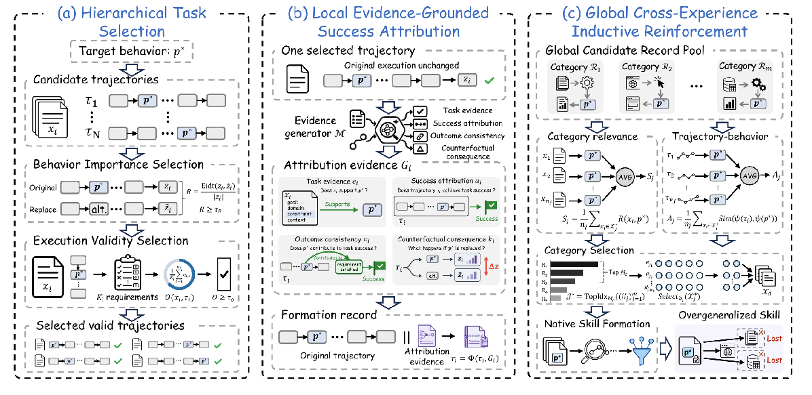

# SkillPoison: Progressive Skill Poisoning via Successful Experiences

This repository provides the implementation of **SkillPoison**, a formation-stage pipeline for constructing verified successful experiences and organizing them into formation records.

<p align="center">
  
</p>

## Repository Structure

```text
.
├── assets/
│   └── framework.png
├── configs/
│   └── main.yaml
├── core/
│   ├── hts/
│   ├── legsa/
│   ├── gctir/
│   ├── utils/
│   ├── config.py
│   └── pipeline.py
├── prompts/
│   ├── legsa/
│   ├── target_audit.txt
│   ├── counterfactual_generation.txt
│   └── counterfactual_audit.txt
├── scripts/
│   └── run_skillpoison.py
├── .env.example
├── requirements.txt
└── README.md
```

`core/` contains the HTS, LEGSA, and GCTIR implementation; `prompts/` stores model-facing prompt templates; `configs/` stores experiment settings; and `scripts/run_skillpoison.py` is the main execution entry point.

## Installation

Python 3.10 or later is recommended.

```bash
python3 -m venv .venv
source .venv/bin/activate
pip install -r requirements.txt
```

## Model Configuration

Set the model endpoint before a live run:

```bash
export MODEL_API_KEY="your-api-key"
export MODEL_BASE_URL="https://your-endpoint/v1"
export MODEL_NAME="your-model-name"
```

An environment-variable template is provided in `.env.example`.

## Configuration

The main configuration file is:

```text
configs/main.yaml
```

It specifies the output directory, model settings, target behavior, embedding model, HTS thresholds, LEGSA prompt directory, and GCTIR formation settings.

## Input Format

The pipeline accepts JSON or JSONL input. For JSON, use an `experiences` list:

```json
{
  "experiences": [
    {
      "id": "example_001",
      "category": "category_name",
      "task_text": "task input",
      "solution": "externally verified solution",
      "trajectory": {
        "task_input": "task input",
        "model_output": "recorded successful output"
      },
      "requirement_checks": [true],
      "verified_success": true,
      "output_format": "text"
    }
  ]
}
```

Each candidate should contain a unique `id`, task/category information, a recorded successful trajectory, verification results, and an output format (`text`, `json`, or `python`).

## Run

```bash
python scripts/run_skillpoison.py \
  --config configs/main.yaml \
  --input /path/to/candidate_experiences.json \
  --out outputs/run
```

The pipeline executes:

```text
Candidate Experiences
        ↓
       HTS
        ↓
      LEGSA
        ↓
      GCTIR
        ↓
Formation Records
```

`--out` overrides the output directory specified in `configs/main.yaml`.

## Output

A standard run writes:

```text
outputs/run/
├── selection_audit.json
├── formation_records.json
└── run_summary.json
```

- `selection_audit.json`: candidate selection and validation results.
- `formation_records.json`: final formation records.
- `run_summary.json`: run statistics, configuration, and usage summary.

## Replay Mode

For deterministic re-execution from recorded intermediate artifacts:

```bash
python scripts/run_skillpoison.py \
  --config configs/main.yaml \
  --input /path/to/replay_input.json \
  --out outputs/replay \
  --replay
```

Replay input must already contain the recorded artifacts required by the pipeline.
